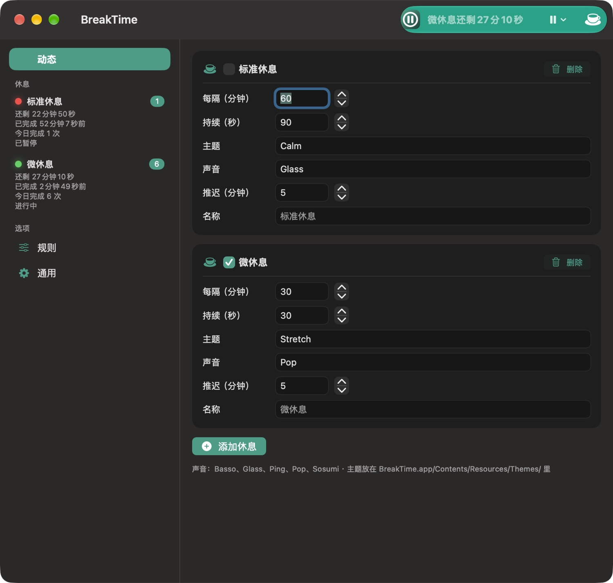
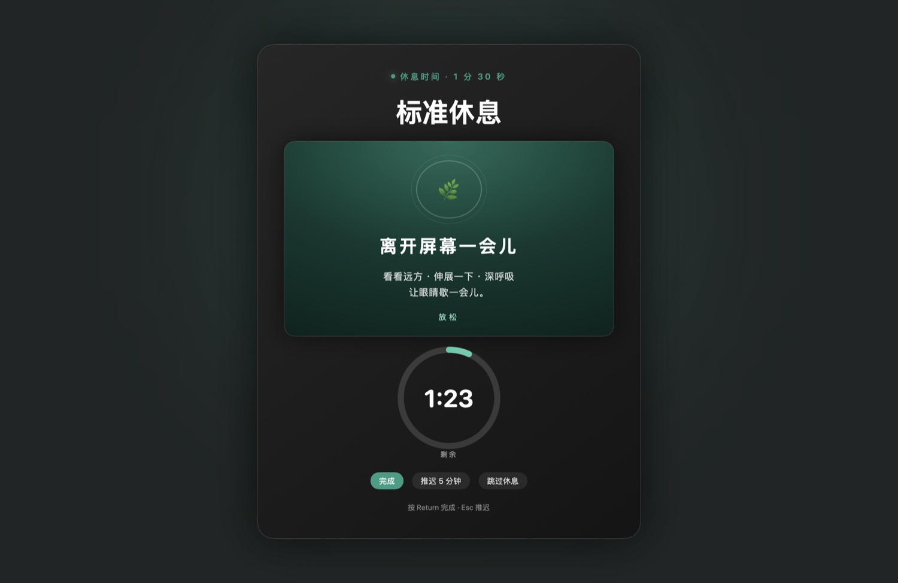
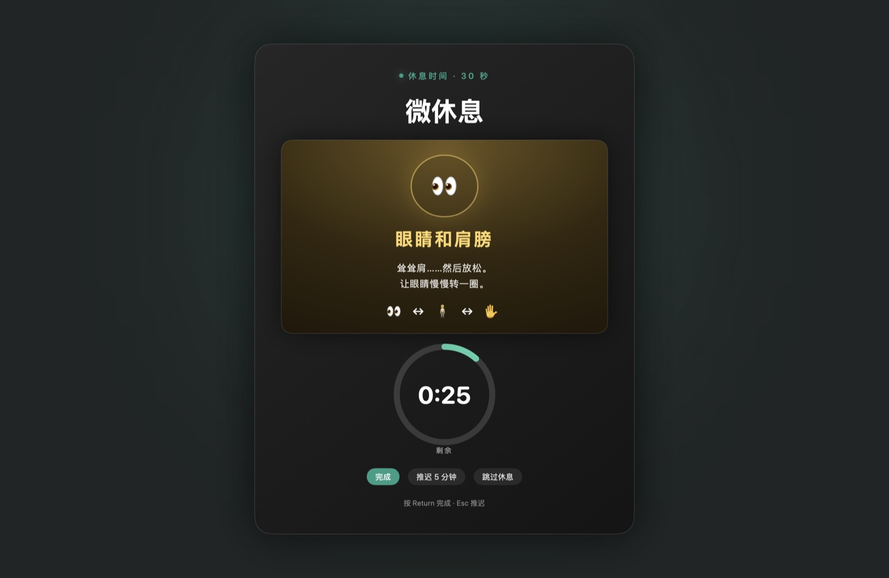

# BreakTime

> 一个中文优先的 macOS 护眼休息提醒小工具。到点用全屏遮罩提示你离开屏幕，支持标准休息和微休息两档节奏。

纯 SwiftUI 手写，**只依赖系统自带的 Command Line Tools**（不需要完整 Xcode、没有任何第三方依赖）。编译产物约 1.4 MB。



---

## 功能

- **两档休息节奏**：标准休息（长时间离开屏幕）+ 微休息（几十秒活动颈肩眼睛），各自独立配置间隔与时长
- **全屏遮罩提醒**：到点后在所有显示器上铺满遮罩，强制你离开当前窗口
- **可自定义主题**：遮罩内容是可替换的 HTML 主题（`.totheme` 目录），改样式不用重新编译
- **中英文界面**：默认中文，可在「通用」里一键切换
- **免打扰规则**：命中规则（在会议 / 某个 App 前台 / 全屏播放）时自动跳过，不会突然糊屏
- **推迟 / 跳过**：`Return` 完成，`Esc` 推迟 N 分钟；支持"休息一小时"临时暂停
- **历史记录**：菜单栏和侧栏显示「还剩多久」「今天完成几次」
- **零权限**：不读窗口标题、不申请辅助功能或录屏权限，装完即用

| 标准休息 | 微休息 |
|---|---|
|  |  |

---

## 安装

### 方式一：下载安装包（推荐）

从 [Releases](../../releases) 下载最新的 `BreakTime-x.y.z.zip`：

```bash
unzip BreakTime-1.0.0.zip
cd BreakTime-1.0.0      # 或解压出的目录
./install.sh
```

`install.sh` 会把 app 放进 `/Applications`（没权限时放 `~/Applications`），并清掉 macOS 的隔离标记。

手动操作也一样：

```bash
cp -R BreakTime.app /Applications/
xattr -dr com.apple.quarantine /Applications/BreakTime.app
open /Applications/BreakTime.app
```

> **为什么需要这一步？**
> BreakTime 没有 Apple 开发者签名（那需要每年 99 美元的账号做公证）。从浏览器下载的 app 会被打上 `com.apple.quarantine` 标记，macOS 会拦截并提示"无法打开"或"已损坏"。上面的 `xattr -dr` 就是清掉这个标记。
> 如果不想执行命令：右键点 app → 打开 → 在弹窗里再点"打开"，只需一次。

### 方式二：从源码构建

完全不碰 Gatekeeper（本地编译的文件没有隔离标记）：

```bash
git clone https://github.com/leaarningandthinking/breaktime.git
cd breaktime
make run
```

---

## 构建

需要 macOS 14+ 和 Xcode Command Line Tools：

```bash
xcode-select --install    # 如果还没装
```

| 命令 | 作用 |
|---|---|
| `make` / `make build` | 编译通用二进制（Apple 芯片 + Intel） |
| `make arm` | 只编 Apple 芯片，快一倍 |
| `make run` | 编译并重启 app |
| `make dist` | 编译并打包成 `dist/BreakTime-<版本>.zip` |
| `make release` | 打包 + 打 tag + 推送（触发 Actions 自动发版） |
| `make clean` | 清理产物 |

不想用 make 就直接跑 `./build.sh`。

---

## 目录结构

```
BreakTime/
├── Sources/                  # 全部 Swift 源码（8 个文件）
│   ├── App.swift             # @main、菜单栏、偏好设置窗口
│   ├── Scheduler.swift       # 休息调度、空闲暂停、超时跳过
│   ├── Overlay.swift         # 全屏遮罩、倒计时圆环、HTML 主题容器
│   ├── Models.swift          # BreakConfig / BreakStore
│   ├── Rules.swift           # 免打扰规则 + 会议检测
│   ├── Localization.swift    # 中英文文案表
│   └── Toast.swift           # 菜单栏浮层提示
├── Resources/Themes/         # 遮罩用的 HTML 主题（可自由替换）
│   ├── Calm.totheme/         # index.html（英） / index.zh.html（中）
│   └── Stretch.totheme/
├── Assets/                   # 图标源文件与 .icns
├── docs/                     # README 截图
├── scripts/                  # make-dist.sh / install.sh
├── Info.plist
├── build.sh
└── Makefile
```

---

## 自定义主题

遮罩内容由 `BreakTime.app/Contents/Resources/Themes/<主题名>.totheme/` 下的 HTML 决定：

- `index.html` — 英文界面用
- `index.zh.html` — 中文界面用（不存在时回退到 `index.html`）

复制一份 `Calm.totheme` 改个名字，在「动态」页把某个休息的「主题」填成新目录名即可。普通的 HTML/CSS，可以加动画、GIF、自定义字体。

---

## 数据与配置

- 配置存在 `~/Library/Preferences/com.leaarningandthinking.breaktime.plist`
- 卸载：把 app 拖进废纸篓，再执行
  ```bash
  defaults delete com.leaarningandthinking.breaktime
  ```

---

## English

A Chinese-first break reminder for macOS. Full-screen overlays nudge you off the
screen on a two-tier schedule (normal breaks + micro breaks), with HTML themes,
exclusion rules for meetings, and a zero-permission footprint.

Built with plain SwiftUI and `swiftc` — no Xcode project, no dependencies.

```bash
git clone https://github.com/leaarningandthinking/breaktime.git
cd breaktime && make run
```

Releases are unsigned, so downloaded copies need
`xattr -dr com.apple.quarantine /Applications/BreakTime.app` (or run
`./install.sh`).

---

## License

[MIT](LICENSE) © 2026 leaarningandthinking
